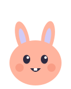
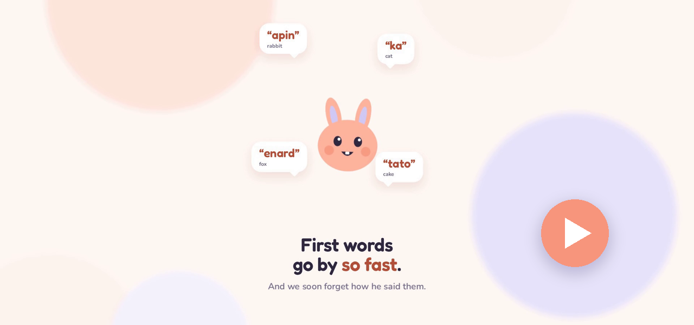
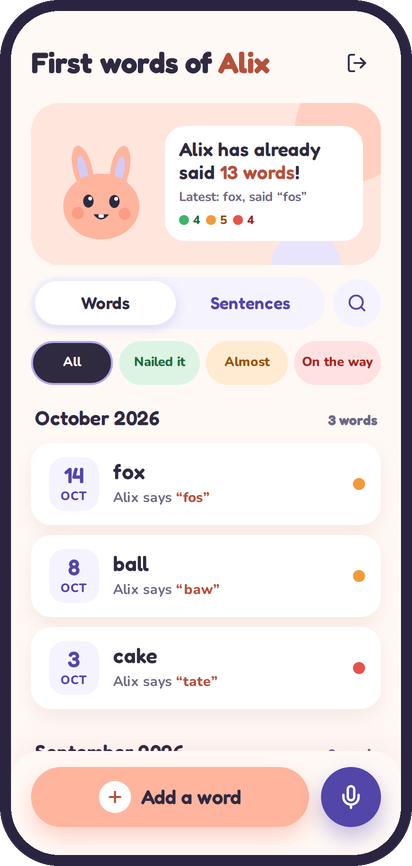
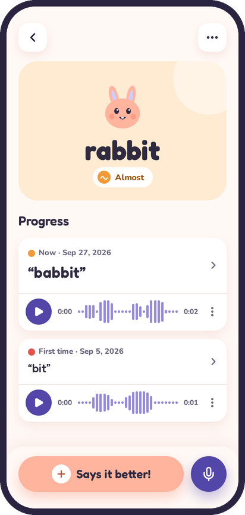
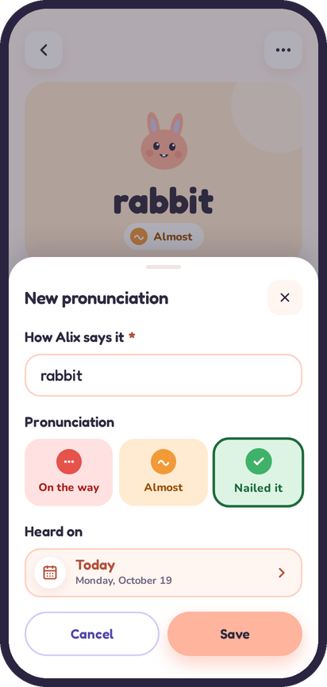
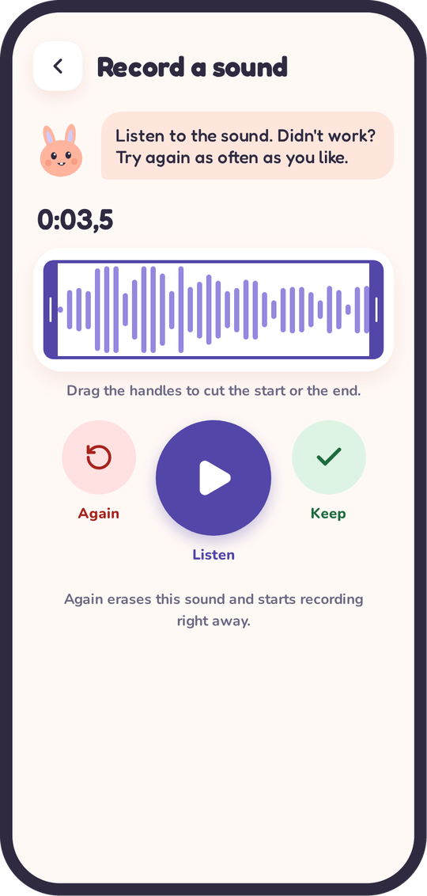

  

<h1 align="center">Little Words</h1>

  <b>The first-words baby book. The one you actually fill in.</b> 
  Log a new word in ten seconds, follow it from "bit" to "rabbit", 
  and keep the sound of that tiny voice for good.

  
  
  
  

  <!-- The tour lives on GitHub's attachment storage, not in git: a new version is dropped into an issue
       editor on github.com, and the URL it gives replaces this one. -->
  
   
  <a href="https://github.com/user-attachments/assets/92dedca2-3f3f-4f5c-95ef-2b74892398e1"><b>&#9654; Watch the 46-second tour</b></a> 
  No sound, no ads, one bunny.

 

## Toddlers speak their own language

"Bit" means rabbit. "Wawa" means water. "Tate" means cake, and also *I want cake right now*.
Three months later the same child says "rabbit" perfectly, and nobody remembers the "bit" anymore.

**Little Words is the family notebook that remembers for you.**

 

<table>
  <tr>
    <td align="center" width="25%" valign="top">
        
      <b>The notebook</b> 
      Every word, the day it showed up, how it sounds today.
    </td>
    <td align="center" width="25%" valign="top">
        
      <b>The journey</b> 
      From "bit" to "babbit" to "rabbit", each step with its sound.
    </td>
    <td align="center" width="25%" valign="top">
        
      <b>The big day</b> 
      They finally nailed it. Two taps, and cue the confetti.
    </td>
    <td align="center" width="25%" valign="top">
        
      <b>The voice</b> 
      One tap, fifteen seconds, kept forever.
    </td>
  </tr>
</table>

 

## What's inside

<table>
  <tr>
    <td width="33%" valign="top">
       
      <b>One notebook, the whole family</b> 
      Parents, grandparents, the nanny: everyone adds words from their own phone. One shared passphrase, zero accounts, zero "forgot your password" emails.
    </td>
    <td width="33%" valign="top">
       
      <b>Every step counts</b> 
      Each word keeps its whole history, marked <i>On the way</i>, <i>Almost</i> or <i>Nailed it</i>. Watching the dots turn green is weirdly addictive.
    </td>
    <td width="33%" valign="top">
       
      <b>That little voice</b> 
      Record up to 15 seconds next to each word. Prime material for an 18th birthday speech.
    </td>
  </tr>
  <tr>
    <td width="33%" valign="top">
       
      <b>Confetti</b> 
      A word reaches <i>Nailed it</i>? Confetti. This is not up for debate.
    </td>
    <td width="33%" valign="top">
       
      <b>Look, don't touch</b> 
      An optional read-only passphrase for relatives who want to follow along without "fixing" anything.
    </td>
    <td width="33%" valign="top">
       
      <b>Yours, really</b> 
      Self-hosted, no store, no ads, no tracking. Add it to the home screen and it feels like an app.
    </td>
  </tr>
</table>

 

## Get it

You bring the toddler, Little Words brings the rest. It ships as two Docker images (API and web, amd64 and arm64) and needs a PostgreSQL database and a reverse proxy that serves both on one origin.

- **Try it**: `docker compose up --build` (or `make up`) runs the whole app on http://localhost:8000, nothing to configure; the passphrase is `littlewords-demo-passphrase`.
- **Host it**: [deploy/](deploy/README.md) is a ready template for one machine (PostgreSQL, HTTPS by Caddy, backups), a domain and four settings away from running. Your server owns its copy, its secrets and its domain.
- **Hack on it**: `make setup && make dev` ([CONTRIBUTING.md](CONTRIBUTING.md#setup)).

What any deployment must provide (routing, variables, health checks, backups) is in [backend/README.md](backend/README.md#deployment).

 

## Technical

Everything is called `littlewords`: repository, Java package, Docker images, containers, database.

| Layer | Stack |
|---|---|
| Frontend | Angular 22 (standalone, zoneless, signals), Tailwind 4 for layout and SCSS for visuals, Transloco (French, English), served by nginx |
| Backend | Spring Boot 4 on Java 25: Spring Security, Data JPA, Flyway, springdoc |
| Database | PostgreSQL 17, recordings stored as `bytea` in their own table |
| Auth | Shared family passphrase (Argon2id), optional read-only one, session cookie, CSRF, login lockout |
| Deployment | Two images behind your reverse proxy: `/api/*` to the backend, the rest to the frontend |
| Quality | Spotless, Checkstyle, SpotBugs, JaCoCo, Testcontainers; ESLint, Stylelint, Prettier, vitest; Playwright against the deployment template |
| Supply chain | Images and actions pinned by digest, Dependabot, dependency review, CodeQL, Grype image scan, SBOM and provenance on every image |

The interface speaks French or English, following the browser (French when it offers neither); so do the word suggestions (French IFDC or American English CDI). The app name and the family's time zone are set per deployment (`APP_NAME`, `APP_TIME_ZONE`), so each family runs its own notebook.

- [CONTRIBUTING.md](CONTRIBUTING.md): setup, code map, conventions. Start here.
- [backend/README.md](backend/README.md): commands, family password, packages, deployment, monitoring.
- [deploy/README.md](deploy/README.md): production template, updates, backups.
- [frontend/README.md](frontend/README.md): commands, folders, routes, styles, components.
- [docs/dictionary/README.md](docs/dictionary/README.md): where the word lists come from (IFDC and CDI via Wordbank, CC BY 4.0).
- API reference: Swagger UI at `/swagger-ui.html` when `API_DOCS_ENABLED=true` (dev only).
