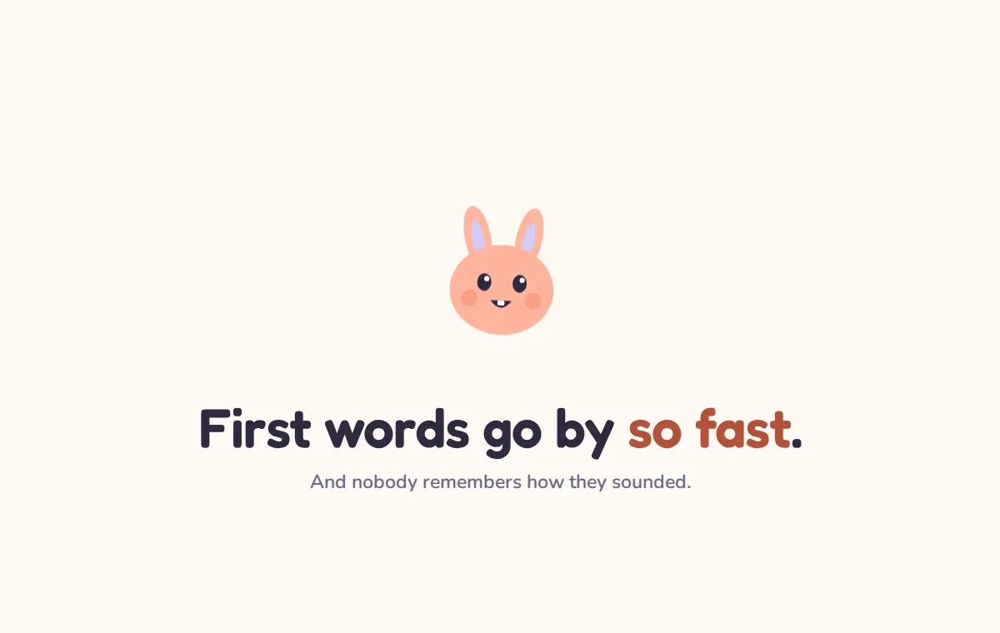
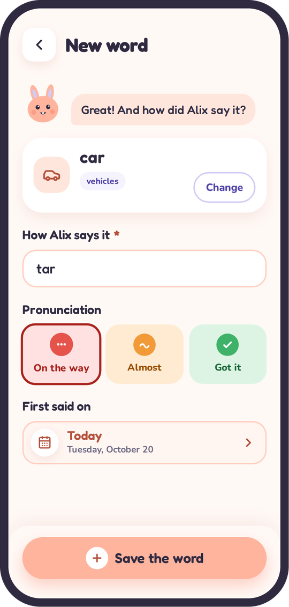
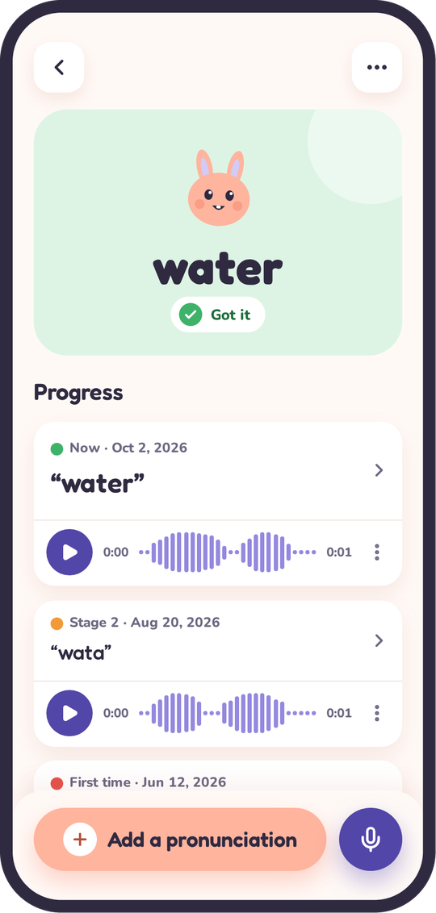
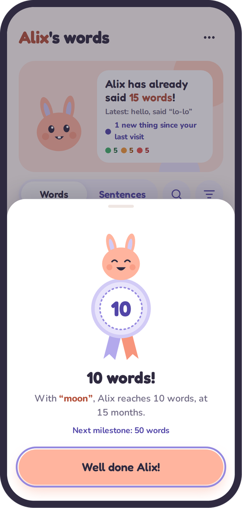

<p align="center">
  
</p>

<h1 align="center">Little Words</h1>

<p align="center">
  <b>The first-words baby book. The one you actually fill in.</b><br>
  Log a new word in ten seconds, follow it from "bit" to "rabbit", and keep that tiny voice for good.
</p>

<p align="center">
  
  
  
  
</p>

<p align="center">
  
  <br>
  <sub>A 40-second tour. No sound, no ads, one bunny.</sub>
</p>

## Toddlers speak their own language

"Bit" means rabbit. "Wawa" means water. "Tate" means cake, and also *I want cake right now*.
Three months later it's "rabbit", perfectly, and nobody remembers the "bit" anymore.

**Little Words remembers for you.**

## A peek inside

<p align="center">
  
  
  
  
  
  <br>
  <sub><b>The&nbsp;notebook</b> · <b>New&nbsp;word</b> · <b>The&nbsp;journey</b> · <b>Medals</b> · <b>The&nbsp;voice</b></sub>
</p>

## Why families love it

<table>
  <tr>
    <td width="50%" valign="top">
      <br>
      <b>One notebook, the whole family</b><br>
      Parents, grandparents, the nanny: everyone adds words from their own phone. One passphrase, zero accounts.
    </td>
    <td width="50%" valign="top">
      <br>
      <b>Every step counts</b><br>
      Each word keeps its story, from <i>On the way</i> to <i>Got it</i>. Watching the dots turn green is weirdly addictive.
    </td>
  </tr>
  <tr>
    <td width="50%" valign="top">
      <br>
      <b>That little voice</b><br>
      30 seconds per step, trimmed in two drags. Prime material for an 18th birthday speech.
    </td>
    <td width="50%" valign="top">
      <br>
      <b>A dictionary that speaks toddler</b><br>
      Nearly 700 first words, the usual ones for their age up front. Not in there? Type your own.
    </td>
  </tr>
  <tr>
    <td width="50%" valign="top">
      <br>
      <b>Look, don't touch</b><br>
      A read-only passphrase for relatives who follow along without "fixing" anything.
    </td>
    <td width="50%" valign="top">
      <br>
      <b>Medals and confetti</b><br>
      10 words, 50, 100, the first <i>Got it</i>, the first sentence. Confetti is not up for debate.
    </td>
  </tr>
</table>

Add it to the home screen and it feels like an app, in French or English, following the phone.

## Get it

You bring the toddler, Little Words brings the rest.

**Try it** in one command, nothing to configure:

```bash
docker compose up --build    # or: make up
```

Then open http://localhost:8000 and sign in with `littlewords-demo-passphrase`.

**Host it** for your family: two Docker images (web and API, amd64) and a PostgreSQL database. Your server writes its own compose, chart or PaaS settings from the contract in [docs/deployment.md](docs/deployment.md): one route, a few variables, one database per family. Several families on one machine? Several stacks side by side.

**Hack on it**: `make setup && make dev`, then [CONTRIBUTING.md](CONTRIBUTING.md#up-and-running).

## Under the hood

<details>
<summary>Stack, quality and supply chain</summary>
<br>

Everything is called `littlewords`: repository, Java package, Docker images, containers, database.

- **Frontend**: Angular 22 (standalone, zoneless, signals), Tailwind 4 for layout, SCSS for visuals, Transloco for French and English, served by nginx.
- **Backend**: Spring Boot 4 on Java 25, with Spring Security, Data JPA, Flyway and springdoc.
- **Database**: PostgreSQL 17, the recordings in their own table.
- **Auth**: one family passphrase (Argon2id), an optional read-only one, a session cookie, CSRF and a login lockout.
- **Deployment**: two images. Your proxy sends the domain to the frontend, which relays the API to the backend.
- **Quality**: Spotless, Checkstyle, SpotBugs, JaCoCo, ArchUnit and Testcontainers; ESLint, Stylelint, Prettier and vitest; Playwright against the images.
- **Supply chain**: images and actions pinned by digest, Dependabot, CodeQL, a Grype scan, an SBOM and provenance on every image.

The interface speaks French or English, following the browser (French when it offers neither); so do the word suggestions (French IFDC or American English CDI). The app name and the family's time zone are set per deployment (`APP_NAME`, `APP_TIME_ZONE`), so each family runs its own notebook.

</details>

- [CONTRIBUTING.md](CONTRIBUTING.md): setup, code map, conventions. Start here.
- [backend/README.md](backend/README.md): daily commands, family password, packages.
- [frontend/README.md](frontend/README.md): daily commands, folders, translations, styles.
- [docs/deployment.md](docs/deployment.md): images, routing, variables, backups, monitoring.
- [tools/dictionary/README.md](tools/dictionary/README.md): where the word lists come from (IFDC and CDI via Wordbank, CC BY 4.0).

API reference: Swagger UI at `/swagger-ui.html` when `API_DOCS_ENABLED=true` (dev only).
